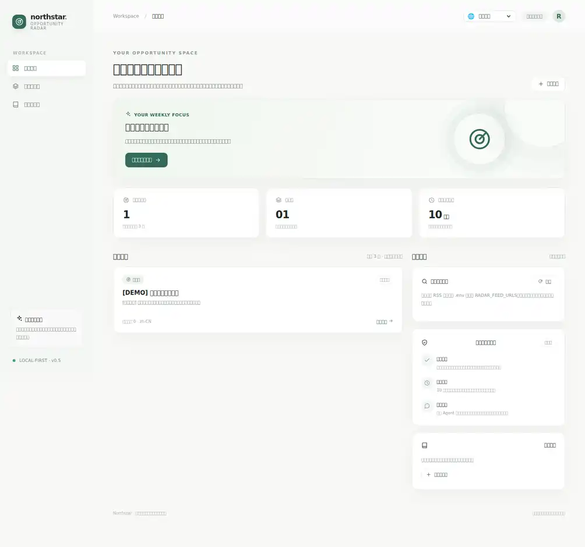
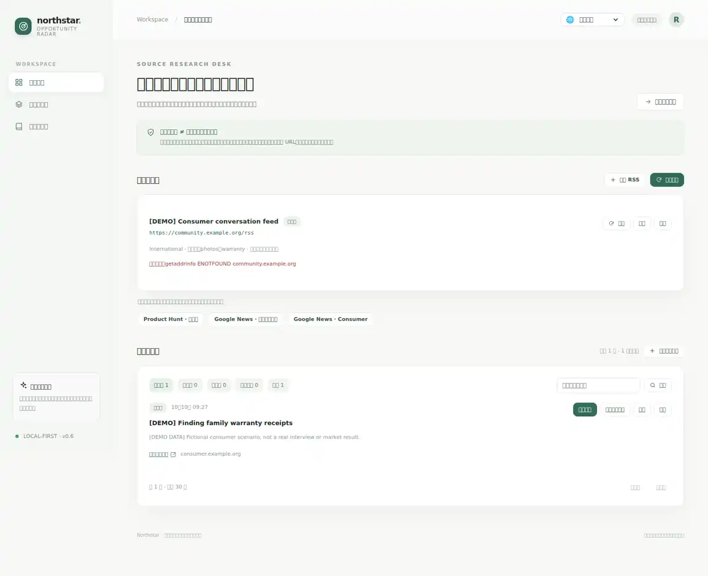
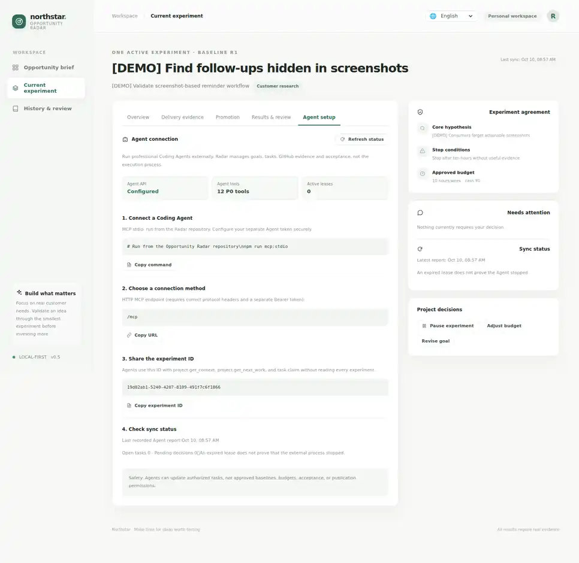

# Northstar · Personal Opportunity Radar

> 个人 To C 机会雷达：发现真实问题 → 批准最小实验 → 外部 Coding Agent 交付 → 真实证据验收 → 创作者宣发 → 收益复盘。

这是依据已批准 **PRD V1.2 / Agent Handoff V1.3** 持续演进的 **v2.23 版本**（支持本机运行或 Docker 服务器部署——单 owner：所有持有 owner token 的人共享同一数据集，详见 [docs/DEPLOY.md](docs/DEPLOY.md)）（当前阶段：安全加固、真实浏览器验证与全球信息源扩充之后），不是已完成真实消费者试点的产品。支持简体中文与 English，界面以轻量项目进度和决策为中心。

## 界面截图 / Screenshots

> 以下为**真实应用前端截图**，使用隔离的临时 SQLite 数据库和明确标记为 `[DEMO]` 的记录，不代表真实消费者研究。截图环境限制 Chromium 直接访问本地 HTTP，脚本将浏览器 API 请求转发给真实本地服务；这不等于完成直接联网的浏览器 E2E 验收。

**机会简报 · 简体中文**



**信息源管理与原始信号工作台（演示数据）**



**Agent 接入中心 · English**



复现方式：`python scripts/capture_screenshots.py`（需要 Python Playwright、Pillow 和 Chromium）。脚本使用临时数据库，不修改真实项目。

## 服务器部署（Docker）

数据存储在服务器的 SQLite（Docker 命名卷持久化），浏览器远程访问，单 owner token 鉴权：

```bash
cp docker-compose.yml .  # 或直接在仓库目录
echo 'RADAR_OWNER_TOKEN=你的强口令' > .env
docker compose up -d --build
```

完整指南见 [docs/DEPLOY.md](docs/DEPLOY.md)；**Dokploy 用户**直接看 [docs/DOKPLOY.md](docs/DOKPLOY.md)（Dockerfile 构建类型原生适配，含 Traefik 自动 HTTPS）。

## 最新更新（v2.10 → v2.16）
- **Jev System One 信号预筛**：配置 `JEV_API_KEY`（走 OpenRouter `openrouter.ai/~typesafe/jev-latest`）即可自动过滤非消费者问题信号，带校准概率与判定理由，可在界面恢复。

- **v2.10–v2.11（Phase D/E）**：证据驱动的机会复盘与决策（继续/调整/暂停/停止必须显式确认，永不自动宣布「已验证」）；SQLite 版本化迁移、备份/恢复校验、加载/错误/离线状态与端到端回归。
- **v2.12 安全加固**：DNS rebinding 防护（无 token 时仅接受回环 Host）、owner 幂等键（`Idempotency-Key`）、移除无防护的抓取死代码、前端渲染防崩。
- **v2.13 走查修复**：账本实际值自动镜像进增长模型（打开旧库幂等回填，增长页与账本永不打架）；已发布内容状态文案与任务时间线修正。
- **v2.22 审查修复批次**：项目事件流超过 100 条不再冻结；复盘恢复同步阶段；账本实际值可修订/撤回（镜像同步）；暂停必登记唤醒条件、恢复需对照确认；排期/统计时间改用日期控件。
- **v2.21 配置与可携带**：复盘周期可用 RADAR_REVIEW_CYCLE_DAYS 配置（默认 7 天）；宣发日历按四态分组；`npm run data -- export` 全量 JSON 导出（明文 0600、拒绝覆盖，备份之外的可读副本）。
- **v2.20 选择理由链**：批准实验必填「为什么是它」的选择依据；机会放弃/继续观察记录原因；两者接入项目契约卡与周期复盘对照区，回答「为什么选择这个机会，而不是其他机会」。
- **v2.19 规则立即应用与版本历史**：一键对待研判队列立即应用静音规则（不必等下次扫描）；内容版本历史可浏览（旧版本与审批失效时间线）。
- **v2.18 静音规则**：owner 定义静音关键词（最多 50 条），扫描新进信号命中即自动忽略并记录规则；只影响扫描新进信号，手动录入不受影响，可恢复且保留命中标注。
- **v2.17 分诊提效**：信号多选批量收藏/忽略（原子事务、逐条跳过报告），来源面板显示待研判计数。
- **v2.14–v2.16 信息源目录扩至 27 个**（中/英/俄/西，CI 真实联网探测全部可达，排除源均附实测证据）；URL 哈希路由（刷新与深链接恢复确切视图）、项目页签换行、`npm run data -- prune-events` 审计事件手动清理（默认 dry-run）；Agent 置阻塞必须给出原因；非活跃项目冻结内容审批与发布登记。

## v2.9 · Phase E · 生产可靠性与用户体验

这一版不新增商业功能，而是把「长期可依赖」补齐到与功能链同等水平：

- **数据库 schema 版本管理**：应用用 `PRAGMA user_version` 落盘 schema 版本，升级旧库只做增量迁移（新增列/索引），旧行逐字节保留；用旧版应用打开新库会明确报 `SCHEMA_TOO_NEW` 并拒绝，而不是误读数据。`npm run data -- doctor` 现在同时报告 `schemaVersion` 与 SQLite 引擎版本。
- **备份溯源**：备份 manifest 记录生成时的 schema 与引擎版本；旧格式 manifest 继续校验通过。备份/恢复的既有安全边界（一致性快照、SHA-256、只恢复到全新路径）保持不变。
- **鉴权与边界加固**：Owner/Agent 令牌校验改为常数时间比较；扫描接口对 `source_id` 做类型校验；signals、来源诊断、任务历史、增长历史/报告等既有分页接口维持有界校验。机会池（`/api/opportunities`）、历史账本（`/api/history`）、来源列表、验证总览与重复候选等接口按单机单人设计仍为全量返回、未分页。测试覆盖 401/403/400/413 边界。
- **可恢复的界面状态**：首次加载显示进度态；加载失败显示带「重试」按钮的错误横幅，并明示数据保存在本机 SQLite 不会丢失——首载失败且没有已加载数据时只显示中性占位，不渲染任何统计或首用引导，不把打不开的旧库误读成空库；断网显示离线横幅、联网自动恢复；导航支持 `aria-current`。曾试验在动作点击上加 UI 级双击防护，因会在连续操作时静默吞掉点击（破坏真实浏览器 E2E 的背靠背导航）而移除；防重复提交保留在模态提交按钮禁用与服务端幂等键/乐观修订号/409 冲突这些更可靠的层面。新增文案中英双语并在 `tests/i18n.test.mjs` 逐键断言。
- **端到端真实业务回归**（`tests/phase-e-http-e2e.test.mjs`，真实 HTTP + SQLite）：验证计划批准 → 实验启动 → Agent 领取与交付 → 退回返工 → 真实 GitHub CI 核验（网络边界 mock）→ 人工验收 → 交付后反馈登记的全链路；并发相同幂等键只产生一次写入；**进程重启**后数据与任务租约保留、过期租约接管必须人工核对；备份恢复后以全新进程打开数据完整。另有 `tests/schema-migration.test.mjs` 覆盖旧库迁移。
- **收尾审计**：[docs/IMPLEMENTATION_AUDIT.md](docs/IMPLEMENTATION_AUDIT.md) 逐项记录既有能力、本阶段补齐与明确未完成事项（含真实浏览器 UI 回归仍未执行）。

自动化测试全部通过不等于真实消费者验证或外部 Coding Agent 已被正式验收；这些仍需在你的环境中以真实参与者完成。

[查看本地操作与灾难恢复手册](docs/LOCAL_OPERATIONS.md)

## v1.9 · 安全信息源采集与原子性恢复

v1.9 重点修复两个可能影响真实使用的信息源故障：

- **安全的公网 HTTPS 采集**：此前仅检查 DNS 后使用通用 `fetch`，真实网络连接可能再解析域名。现改为 Node 原生 HTTPS 请求，**把连接 IP 固定到已经检查过的公网 DNS 结果**，TLS SNI 和证书仍按原始订阅域名校验。重定向地址重新进行 HTTPS 与公网 IP 检查，防止借 RSS 扫描访问本机或内部服务。
- **每个信息源原子导入**：RSS 单次响应的文章、去重来源关系和采集成功时间在同一个 SQLite 事务中提交。如果导入中途发生磁盘错误、脏数据或更新冲突，会回滚该来源所有新写入；错误计数和退避仍会保存，成功统计也不会计算已回滚的数据。
- **无额外运行依赖**：继续使用 Node 22 内建 `node:https`、`node:sqlite` 与 `node:dns`，无浏览器自动化抓取与登录绕过。
- **持续验证**：新增真实网络请求选项级的 IP 锁定单测、混合公网/私网 DNS 阻断、错误中途回滚、健康来源隔离测试。GitHub Actions 在相关代码变更时运行公开 RSS 可达性探测；公网源失败会如实记录，不伪称网络始终可用。

这类防护降低 DNS 重绑定与部分导入风险，但不能取代操作系统网络沙箱、长期监控或真实消费者研究。仍建议默认绑定 `127.0.0.1`。

[查看信息源管理与采集说明](docs/SOURCE_DISCOVERY.md)

## v1.8 · 本地可用性、首次配置和可靠的数据恢复

这一版不再增加无验证的商业机会评分，而是打通**首次运行 → 真实信息源 → 研究记录 → 安全备份和故障恢复**所需要的基本运营能力：

- **首次使用引导**：没有真实来源时，首页优先引导添加来源。信息源页新增「首次使用与数据安全」，显示启用数量、是否曾成功采集、待人工处理的实际信号和保存机会的状况；不能把默认订阅或演示信号当作连通性成功。
- **完整本地备份**：新增 `npm run data -- backup --output /path/private.sqlite`，支持应用运行时通过 SQLite `VACUUM INTO` 读取一致性 WAL 快照，包含来源、机会、访谈、任务、账本及事件。生成 SHA-256 manifest，同步验证 SQLite 完整性和应用记录字段。
- **备份验证**：`npm run data -- verify --input /path/private.sqlite`，比对文件校验和、格式、记录数量，损坏、缺少 manifest 或不匹配会明确失败。大数据库按 1MB 数据块计算 SHA，避免整库一次性载入内存。
- **安全恢复**：`npm run data -- restore --input /path/private.sqlite --destination /path/recovered.sqlite --confirm`。恢复前后核查内容，**只创建新的数据库路径，不覆盖现有数据**；通过 `RADAR_DB` 切换。新增 `data doctor` 供迁移前检查。
- **隐私保护**：备份为**未加密**的本地 SQLite，可能含私人访谈或未发布研发材料；只通过受信任的本地 CLI 生成与恢复，不增加网页远程下载数据库的接口。默认 `private-backups/` 和 manifest 已加入 Git 忽略规则。
- 覆盖真实 Node HTTP 认证与首次状态、Chromium 页面、SQLite WAL 运行中备份、跨进程 CLI、数据损坏拒绝、现有路径保护以及恢复后继续读取实际机会的数据测试。

**本地完整使用与灾难恢复手册**：[docs/LOCAL_OPERATIONS.md](docs/LOCAL_OPERATIONS.md)

> 功能链在单机可以运行，但不意味着外部公网来源的长期可用性、真实专业 Coding Agent 自主开发或真实消费者愿意付费已通过生产环境测试；这些仍需要在你的运行环境完成实际验收。

## v1.7 · 机会发现质量反馈与转载风险识别

- **为什么相似**：重复问题候选组显示共同标题词和组内最低词汇相似度，避免难以判断系统为什么将文章放在一起。
- **疑似转载提示**：重复归一化标题、相同的较长摘要、同站点重复署名会触发风险提示；**这只是线索，不能自动证明转载或独立用户身份**。
- **人工标记相关**：Owner 可在逐条阅读原文后，记录「同一问题线索、仍待验证」及具体理由。标记不会创建机会、增加有效用户数或批准任何产品实验。
- **结构化误报反馈**：忽略候选时区分「疑似转载」「实际不同问题」「不是消费者问题」「其他」，并保存理由。原有未分类忽略记录兼容为其他。
- **受限质量统计**：只统计当前候选窗口内有效的 Owner 标签数、疑似转载数、人工排除数等；标注不足五组时不显示人工判断比例。**人工判断不等于独立标签集，不能称为自动聚类准确率。**
- **审查版本有效性**：当组成员增减、标题、摘要或署名变化时，先前的判断不自动沿用，必须刷新重新核查。
- 新增 Owner-only `GET /api/discovery/quality`、`POST /api/discovery/clusters/:id/review` 的 `action=confirm` 和可选的 `classification`，中英文工作台支持人工操作。
- 自动化覆盖基于原始字段的解释、误报标注、版本失效、权限、直接浏览器交互，以及小型离线测试样本。**跨语言语义模型与真实生产数据上的召回/精度暂不宣称实现或验证**。

[查看 v1.7 使用、验证与边界](docs/DISCOVERY_PRECISION.md)

## v1.6 · 跨来源重复问题候选工作台

把已经订阅、实际采集或手动保存的公开信号进一步整理成**人工可核查的问题候选**，减少每日逐条搜索的负担：

- 在「机会简报 → 信息源与信号」增加 **重复问题候选** 工作台。只对最近最多 600 条、尚未关联机会或忽略的信号进行保守标题相似度检测；**至少 2 个不同原始 URL** 才能形成一组。
- 每组显示各条**真实原文 URL、来源站点、作者署名（若有）**；跨来源出现不等于独立消费者，相关数量不能被当成市场规模、付费意愿或有效用户数。
- **人工创建**：从组内第一条建立待验证机会，后续要通过真实原文继续确认。没有人工操作时，不自动创建或升级商业机会。
- **原子批量关联**：Owner 可在确认“未经验证”的前提下，把同组原始链接全部加入已有机会，保存为 `firsthand=false, independent=false` 的待核查证据；若发生错误，SQLite 会回滚整个操作，避免部分导入。
- **忽略与恢复**：忽略候选组必须写理由。忽略仅针对当时的成员指纹；新增相似原文后，候选会重新进入待核查队列。
- 新增 `GET /api/discovery/clusters`、`POST /api/discovery/clusters/:id/review` 和 `POST /api/discovery/clusters/:id/link`，全部 Owner-only；现有采集、来源管理及 Coding Agent 能力不受影响。

**局限**：这不是语义理解模型，只能保守聚合标题高度相近的公开信息；可能漏掉同义不同说法，也可能把转载误认为不同来源。仍需人工阅读全文、联系实际消费者和验证付费行为。

[查看使用与测试说明](docs/REPEATED_PROBLEM_DISCOVERY.md)

## v1.5 · 受控编码执行与本地审计

- `agent:pilot run` 增加 **1–240 分钟可配置运行上限**（默认 90 分钟），超时先请求 `SIGTERM`，短暂等待后尝试强制结束主编码进程；`Ctrl+C` / `SIGTERM` 可以发起取消。
- 编码进程无法续租或主动取消时，停止继续执行，记录失败，并尝试释放自己的任务租约。**不能把终止主进程等同于所有后台子进程或外部副作用已停止**。
- 每次运行在用户本机的 `~/.opportunity-radar/runs` 保存权限限制为仅当前用户可读写的 **脱敏 JSON 执行回执**：项目与任务、基线、开始/结束时间、退出状态、Git HEAD 前后变化和修改文件数量。**不保存原始访谈、Prompt、模型输出、Bearer Token 或源码 Diff**。
- `agent:pilot status --project ...` 增加最近十条**本地**运行回执；即使编码命令退出 0，也不代表代码成功通过 CI 或用户验收。未能终结的回执只保留最后观察状态，不能据此断言进程仍在线。
- 运行页面新增可复制的受控命令，中英文提示超时、取消和人工检查义务。
- CI 新增挂起进程超时、人工取消、子进程错误退出、本地审计文件权限及敏感信息脱敏测试。

```bash
npm run agent:pilot -- run --project <PROJECT_ID> \
  --workspace /path/to/product --provider codex \
  --timeout-minutes 90 --confirm

npm run agent:pilot -- status --project <PROJECT_ID>
```

[查看使用与故障恢复说明](docs/CODING_AGENT_PILOT.md)

## v1.4 · 可恢复的 Coding Agent 交付与人工接管

- `agent:pilot status` 是**只读**任务诊断：展示当前批准基线、任务、租约到期时间和交付申请，不打印租约 Token。
- `agent:pilot recover --task ... --recovery-note ... --confirm` 提供人工恢复动作：只有租约确实过期、明确确认后才可接管并释放。系统不声称原编码进程已经停止；没有到期租约不能强行抢占。
- `agent:pilot submit` 现在具有**持久幂等性**：证据已创建、任务已提交、交付已创建三个节点的网络/进程故障都可以重试；相同 PR + SHA 重放不会产生重复证据或交付，Owner 已退回的旧 SHA 不可重新冒充新版本。
- 新提交证据标注到具体任务和已批准基线；当多个候选任务存在时，必须指定 `--task`，防止将 PR 归给错误任务。
- `submit` 仍需实际查询 GitHub PR HEAD；产物仍是**待独立核验的证据**，不能代替 G1 CI、Owner G4 验收或真实消费者验证。
- 新增真实 **HTTP Agent 认证 + SQLite** 集成测试，不只是服务层函数模拟；新增六组断线重试、同 SHA 拒绝、人工恢复回归测试。

[操作手册与故障恢复](docs/CODING_AGENT_PILOT.md)

## v1.3 · 实际 Coding Agent CLI 桥接

新增可运行的 **Codex CLI / Claude Code CLI** 试点接入器，减少外部 Agent 工程交付时的手动复制与虚假结果：

- 在「当前主实验 → Agent 接入」直接复制试点命令，也可以从 Radar 仓库执行 `npm run agent:pilot -- doctor|plan|run|submit`。
- `doctor` 检查 Agent API 权限、当前可领取任务、干净的 Git 功能分支、编码 CLI 是否安装；`plan` 从已批准基线生成不含原始消费者访谈的任务提示。
- `run --confirm` 才会调用本地 Codex/Claude Code，并为任务领取、续租和释放执行责任；**编码进程退出成功不等于 GitHub 已交付**。
- 用户人工审核源码、执行测试、commit、push、创建 PR 后，用 `submit --confirm --pr ... --sha ...` 提交；必须同时满足本地 Git HEAD、仓库 origin 和 **真实 GitHub PR HEAD** 的精确 SHA 对齐。
- 系统仍将交付证据标为待核验；Owner 另行进行原生 GitHub 必需 CI 检查并实际操作原型后才能通过 G4。它不会自动 push、发布、验收或提升预算。
- 编码子进程不会继承 `RADAR_AGENT_TOKEN`、`RADAR_OWNER_TOKEN` 或 `GITHUB_TOKEN`；工作区文件仍可被外部编码工具读取，应使用隔离代码工作区、不把密钥写入其中。

**运行示例与安全说明**：[Coding Agent 试点使用手册](docs/CODING_AGENT_PILOT.md)

## v1.2 · Agent 交付、返工与断线恢复可靠性

- 将交付、返工和恢复流程变成**外部独立 MCP stdio 进程运行的自动化集成测试**。真实启动另一个 Node 进程，经 JSON-RPC 调用 12 项 Agent 工具、对 SQLite 进行读写，而不是在应用服务内直接模拟 Agent。
- 在交付版本 A 被 Owner 退回时，对应里程碑已提交任务回到 `rework`，记录原因与旧 SHA，并废止旧租约；Agent 可以领取修复任务并以版本 B 新证据重新提交。原先待核验的 GitHub 证据不会被自动变绿。
- `task.claim` 拒绝过期基线和未完成依赖，Agent 自建任务绑定当前已批准基线；修改基线后旧任务无法再次领取或修改。
- 模拟独立 MCP 进程崩溃、租约过期、核对外部副作用后重新领取，并确保过期 fencing token 不能再写入状态。
- Agent 接入中心显示**最近进度报告是否过期、过期租约、返工任务、待验收交付**，不会将有效租约说成外部进程“在线”。
- 新增真实 GitHub API 的独立探测工作流：对**以前已经通过 CI 的提交**核验 exact SHA 与必需 `test` check，并验证错误 SHA 无法继承成功结果。这是外部证据集成测试，**不等于外部 Coding Agent 真实写代码或用户验收通过**。

[查看真实进程与证据验收说明](docs/AGENT_E2E_RUNBOOK.md)

## v1.1 · 用户研究到产品交付的可追溯闭环

- 完成 Owner 主动批准并最终关闭为 **continue** 的用户研究计划后，可将该研究决策关联到新产品实验；仍进行中、其他机会或以调整/停止/证据不足结束的计划不能被伪装为获批准研究。
- 在项目概览由 Owner 点击 **准备首个研发任务**，根据当前批准的目标、范围和验收标准创建唯一可领取任务；变更基线后旧待领任务失效，需重新准备。
- 在产品基线中固定该研究决策的摘要、反证数量和局限，外部 Coding Agent 可通过 `project.get_context` 读取不含参与者代号和逐字访谈的研究概览。
- 兼容既有未关联研究的项目，明确标注 **unlinked**，不伪称真实消费者需求成立；正式产品目标、范围、预算与启动执行仍由 Owner 独立审批。
- 产品研发里程碑正式由 Owner 验收后，项目「结果与复盘」可记录匿名、取得同意的真实使用反馈（核心任务、再次使用、障碍、需求），无产品验收则拒绝记录交付后的使用行为。
- Owner-only `GET/POST /api/projects/:id/feedback`。反馈始终是 **Owner-reported / 未独立核验**，与收入、获客和用户使用的自动分析系统相区分。

[研究到交付使用说明](docs/RESEARCH_TO_DELIVERY.md)

## v1.0 · 真正的开发前消费者验证

- 每条机会新增 **用户验证**：明确目标消费者、可证伪假设、接触渠道、成功证据、停止条件、下一步和 10 小时以内的研究预算。
- 用户手动记录获得同意的匿名访谈与真实行为，分别标注支持、反驳和不确定，支持附上可复查的 HTTPS 证据链接。**禁止用虚构示例当成真实访谈**。
- 一轮验证由 Owner 亲自选择 **继续 / 调整 / 停止 / 仍未知**，必须写出依据。没有观察不能作出继续投入决策，继续也不代表批准产品研发。
- 浏览器提供查看与编辑完整工作流，SQLite 持久化、计划版本校验、Owner-only API 及测试。已批准的产品实验与 Coding Agent 项目机制没有被改变。
- 记录中的“匿名参与者”和“访谈结果”均是人工填写而非外部核实；仍必须开展真正的消费者招募，不能把应用测试数据当作市场验证。

## v0.9 · 真实来源的质量反馈

- 在 **信息源与信号** 页面显示当前数据的质量反馈：全局去重信号、关联机会、含人工核查经历的来源，以及采集异常。
- 每个来源显示该来源收录、收藏、忽略、关联机会数，及关联证据中人工阅读过的原文与第一手经历分类。
- 直接点击 **研判该来源**，进入该来源的待处理信号队列；保存、忽略、关联或回到机会研究时，计数由现有 SQLite 记录实时计算。
- **来源计数不可相加为独立消费者数**：同一 URL 可以出现在多条订阅中；同平台同作者的两篇帖文不会自动算作两个独立的人。
- “第一手经历”仅为 Owner 阅读原文后的人工分类，没有核验发帖者身份；**采集量和关联数都不证明需求规模、付费意愿或真实留存**。
- 新增 Owner-only `GET /api/source-quality`，返回实时观察统计，不依赖 AI，也不保存凭空生成的质量评分。

## v0.8 · 精选信息源与可解释的机会证据

- 可选安装六个问题型 RSS 频道：V2EX 问与答/生活/Apple、Ask HN、Super User 与 Web Applications。**默认不安装，也不把订阅当作消费者验证。**
- 新增来源筛选和公开作者署名（如可获得），从原始信号到机会可保留来源关系。
- 机会池新增 **研究证据**：原始链接、人工核查的第一手经历、独立性、反对理由、证据缺口及下一次访谈建议；不输出虚假的市场概率、收入与付费意愿。
- 允许 Owner 核查原文并写下独立性理由；只由文字标题相似不能自动关联用户需求。
- **外网来源测试**：`npm run catalog:probe`；开发容器无法解析公网 DNS，远程 Actions 单独报告实时状态。

[精选信息源研究](docs/CURATED_SOURCES.md) · [信息源工作台说明](docs/SOURCE_DISCOVERY.md)

## v0.7 长期采集与来源健康状态

- **按来源计划采集**：每个已启用来源可以设置 15–1440 分钟的采集间隔（默认 360 分钟）。服务启动会扫描已经到期的来源，之后每分钟检查一次是否有到期任务；不会每分钟重复下载全部来源。
- **条件请求**：服务保存 RSS `ETag` / `Last-Modified`，下次发送 `If-None-Match` / `If-Modified-Since`；遇到 HTTP 304 会更新健康状态，不会重复导入信号。
- **失败恢复**：连续网络或源错误会将后续采集逐级延后（上限 24 小时），尊重 `Retry-After` 限制；扫描成功后恢复设定的正常间隔。错误次数、最近成功、下次计划均持久化，重启后保留。
- **避免竞争**：手动扫描与后台扫描不会并发写同一份信号；若已有扫描进行中，返回明确的 `SCAN_IN_PROGRESS`（HTTP 409），需要等待再试。
- **来源可观察**：在来源页面查看「已启用 / 到期 / 异常」聚合状态，逐来源显示间隔、下次运行和连续失败次数；`GET /api/sources` 包含 `health`，`/api/health` 包含 `sourceHealth`。
- **已有数据兼容**：旧订阅缺少计划字段时使用默认间隔；更改关键词将重置条件缓存并尽快重新采集，避免此前过滤掉的文章无法被重新发现。

采集基于公开 RSS/Atom，**不保证所有来源全天候可用，也不将 RSS 文章直接视为已证实的消费需求**。RSS 的公网 DNS 预检有防护但不构成独立的完整网络沙箱；不要将该服务暴露到不可信网络。源码与测试详见 `src/source-hub.mjs`、`src/source-scheduler.mjs` 及 `tests/source-reliability.test.mjs`。

## v0.6 信息源与机会发现

- 页面中直接管理公开 RSS / Atom 来源：添加、编辑、暂停、恢复、手动扫描，查看采集结果与失败原因。
- 支持关键词、目标市场、信号搜索、分页、收藏、忽略与恢复；原始来源 URL 保持可追溯。
- 已收藏信号可转换为新的消费者机会，或关联已有机会；重复导入受保护。
- 不提供 RSS 的网站可手动保存公开网页线索，避免自动推断消费者的真实需求。
- 周度高优先级机会仍控制在 3 项，但支持查看完整机会池，而不是隐藏其他机会。
- 支持可选的公开订阅源模板；不会在未授权时自动抓取私密内容。
- 详细使用方法参见 [信息源与机会发现使用指南](docs/SOURCE_DISCOVERY.md)。

> README 截图由真实前端和独立的演示 SQLite 数据库生成。演示信息不是经过用户访谈验证的需求，也不能等同于真实市场机会。

## v0.5 Agent 接入中心

- 在「当前主实验 → Agent 接入」查看 Agent API 的配置状态、12 项 P0 工具、有效租约、待领任务及同步信息。
- 复制 MCP stdio 命令、HTTP MCP 地址与当前实验 ID；页面**不会暴露 Agent Token**。
- 新增由 Owner 权限保护的只读 API：`GET /api/agent/setup?project_id=<project-id>`，提供安全的集成概要。
- 支持中文与英文切换，离线状态不冒充正在运行。雷达不管理外部 Agent 进程。

## 运行

要求 **Node.js 22.16+**；无需数据库安装或 `npm install`，使用 Node 原生 SQLite，初期会看到 Node 实验性功能提示。

```bash
cp .env.example .env
npm start
```

Windows PowerShell:

```powershell
Copy-Item .env.example .env
npm start
```

浏览器打开 **http://127.0.0.1:4177**。数据默认保存在 `.data/radar.sqlite`（不会纳入 Git）。第一次打开没有模拟市场数据，这是刻意的设计。

默认仅监听本机。需要给其他设备访问时，先配置高强度的 `RADAR_OWNER_TOKEN`，使用 HTTPS 反向代理和可靠的网络访问控制；不要把本地 HTTP 服务直接暴露到互联网。

未配置 `RADAR_OWNER_TOKEN` 时，服务器只接受 Host 为本机回环地址（`127.0.0.1` / `localhost` / `[::1]`）的请求（DNS rebinding 防护）；确需以其他主机名访问时，用 `RADAR_ALLOWED_HOSTS=host1,host2` 显式豁免。所有创建类接口（机会、实验、宣发活动、账本）支持可选的 `Idempotency-Key` 请求头：带上该头时，同键同内容的重复提交只会写入一条记录，同键不同内容返回 409；不带该头行为不变。

### 可选配置

编辑 `.env`：

```ini
RADAR_PORT=4177
RADAR_OWNER_TOKEN=your-private-owner-token
RADAR_AGENT_TOKEN=your-separate-agent-token
GITHUB_TOKEN=github-read-only-token
RADAR_REQUIRED_CHECKS=test
RADAR_FEED_URLS=https://your-approved-source.example/rss
RADAR_LLM_BASE_URL=https://api.deepseek.com
RADAR_LLM_MODEL=deepseek-chat
RADAR_LLM_API_KEY=your-private-api-key
```

- `RADAR_AGENT_TOKEN` 独立于用户令牌，用于授权外部 Coding Agent 的 HTTP 工具调用；未设置时 Agent API 禁用。
- `GITHUB_TOKEN` 用于读权限范围内的 GitHub commit、PR、check runs 核验。公开仓库可尝试免 Token，但频率和权限有限。无法读取时将保留 **pending**，不会自动判成功。
- `RADAR_FEED_URLS` 最多五个用户指定的 HTTPS RSS/Atom 来源；配置后由来源独立的采集计划调度（默认每 6 小时），也可以手动扫描。原始文章只是「公开信号」，需你确认后才进入机会池。
- `RADAR_LLM_*` 可选 OpenAI-compatible Chat Completions 接口：帮助从真实信号起草机会分析、根据已验收功能准备宣发草稿。**LLM 输出从不直接成为已验证事实**。上传的信号和项目概要会发送给你选择的提供商。

## v0.3 交付可靠性更新

- **不可变验收基线同步**：修改验收要求后，自动对齐产品交付里程碑；旧基线提交不能直接验收。
- **提交证据隔离**：证据必须属于该里程碑，验收前检查是否为最新且尚未处理的提交。
- **GitHub 必需 CI 检查**：仅检查配置的必要检查，对应准确的 40 位提交 SHA；重跑失败、运行中或版本不一致不予通过。可选检查失败不会误阻塞。
- **防止人工绕过 G1**：GitHub 证据不能通过手动备注代替真实 GitHub API 检查；产品原型交付必须具有已核验的 GitHub CI 证据。
- **强幂等重试**：同一幂等键重放相同请求会返回原结果；换用其他操作或参数会明确返回 `IDEMPOTENCY_CONFLICT`。升级已有数据库时会自动增加签名字段；旧版写入但未记录签名的键请重新生成，避免重放不安全结果。

## 当前可用的功能

| 体验 | 实际范围 |
|---|---|
| 机会简报 | 手动录入消费者问题及来源 URL、URL 去跟踪参数去重、0–3 个本周候选、RSS 信号扫描、可选 AI 分析 |
| 实验决策 | 一个主实验、批准时锁定目标/验收/10 小时基线/现金上限/停止条件、版本化修订 |
| Coding Agent | 12 项业务工具，支持 HTTP/JSON、现代 MCP Streamable HTTP 与 MCP stdio（兼容模式）；P1 多 Agent `collaboration.handoff` 不启用 |
| 项目进度 | 单页里程碑、Agent 自报、证据与人工验收分层，离线同步时间明确 |
| GitHub 证据 | 精确 SHA 校验、PR head 匹配、相关 Check Run 检查；不可访问或缺 CI 时不会通过 |
| 个人创作者宣发 | 内容包、可选 AI 起草、人工检查批准、用户手动发布、发布链接记录；禁止自动发帖 |
| 结果账本 | 真实/估计分离、曝光/试用/复用/收入/退款/直接成本、用户时间与 Agent 时间分开 |
| 历史与复盘 | 查看历史试验与预算版本，保留暂停记录 |

## 外部 Coding Agent 接入

使用独立 `RADAR_AGENT_TOKEN`，通过 `Authorization: Bearer <token>` 调用 12 项工具。不需要让 Agent 修改应用数据库。

```bash
# 查看首版可用工具
curl -H "Authorization: Bearer $RADAR_AGENT_TOKEN" \
  http://127.0.0.1:4177/api/agent/tools

# 获取已由用户批准的项目基线；PROJECT_ID 从项目 API/UI 获取
curl -X POST http://127.0.0.1:4177/api/agent/tools/project.get_context \
  -H "Authorization: Bearer $RADAR_AGENT_TOKEN" \
  -H 'Content-Type: application/json' \
  -d '{"project_id":"PROJECT_ID"}'

# 在已批准的里程碑下新增任务（写操作需要幂等键）
curl -X POST http://127.0.0.1:4177/api/agent/tools/task.upsert \
  -H "Authorization: Bearer $RADAR_AGENT_TOKEN" \
  -H 'Content-Type: application/json' \
  -d '{"project_id":"PROJECT_ID","milestone_id":"MILESTONE_ID","title":"完成最小原型","idempotency_key":"unique-call-001"}'
```

Agent 负责自行运行代码和提交交付结果；平台**不启动、管理或终止外部 Agent 进程**。任务租约过期后，重新领取需明确确认外部工作状态，以减少重复执行风险。项目批准基线、预算、正式验收、宣发授权只有用户能改。

查看 [Agent 工具契约](docs/AGENT_TOOL_CONTRACT.md) 了解预定字段；当前 HTTP API 的可用字段以 `src/service.mjs` 和测试用例为准。现已提供 MCP 接入方式，详见下文。MCP 只是传输适配，最终的项目验收和审批仍由 Radar 独立管理。

## MCP 连接专业 Coding Agent

### 方式一：本地 MCP stdio（兼容传统 Coding Agent 配置）

通过标准输入/输出 JSON-RPC 连接，不需要先启动 HTTP Web 服务；数据仍写入同一个 SQLite 文件。请仅在受信任的本机执行环境里使用，因为本地文件访问权限由操作系统管理。

```json
{
  "mcpServers": {
    "opportunity-radar": {
      "command": "node",
      "args": ["/absolute/path/to/opportunity-radar/src/mcp-stdio.mjs"],
      "env": {"RADAR_DB": "/absolute/path/to/opportunity-radar/.data/radar.sqlite"}
    }
  }
}
```

### 方式二：MCP Streamable HTTP（2026-07-28）

先在 `.env` 设置独立 `RADAR_AGENT_TOKEN`，运行 `npm start`，然后连接 `POST http://127.0.0.1:4177/mcp`，使用 `Authorization: Bearer <RADAR_AGENT_TOKEN>`。客户端须发送 `MCP-Protocol-Version`、`Mcp-Method`、必要时 `Mcp-Name` 与 `params._meta`；支持 `server/discover`、`tools/list`、`tools/call` 和 `ping`。此版本不使用远程会话。

为降低兼容性风险，HTTP 入口仅接受 2026-07-28 版本；stdio 入口实现老式 `initialize`/`tools/list` 流程。两者都只开放 12 项首版能力，且永远不能代替用户正式验收。`task.claim` 可凭有效 `lease_token` 续租，过期接管仍要求外部状态核对。

## 检查

```bash
npm test
npm run check
```

测试包含：权限分离、HTTP 真实往返、单主实验、证据去重、基线不可原地修改、写操作幂等/并发冲突、任务租约、Agent 自报与验收隔离、内容审批、现金记录、离线项目状态等。

CI：`.github/workflows/ci.yml` 已配置；真正的远程 CI 运行及证据仍需要在仓库更新后核验。

## 已知限制和下一阶段

本版为功能可运行的第一轮迭代，尚不能声称 **PRD V1.2 P0 / T1–T4 已正式验收通过**：

1. 未接入真实外部 Coding Agent 的完整开发—PR—CI—产品验收闭环；平台仅提供 12 项 JSON 工具，已提供 MCP stdio 与 HTTP 适配，但尚未完成真实第三方 Agent 的互操作测试。
2. 尚无被批准的真实 To C 消费者试点、真实用户反馈和真实收入。
3. RSS 来源需要你配置，公开信息只作为线索；LLM 内容需要另行提供密钥和人工审查。
4. 发布流程只记录**用户手动发布**，不自动登录社交账号或运行广告。
5. 内容的语义真实性需要用户核对；规则层校验来源字段不能代替真实事实核查。
6. 真正的 T1 正常交付、T2 返工、T3 外部 Agent 离线恢复、T4 消费者宣发闭环仍待真实测试。
7. 单机个人使用为默认设计，没有组织账户、跨设备同步或分布式锁。Node 原生 SQLite 仍处于实验性状态。

## 产品基线与安全边界

- 原始批准文件位于 `docs/PRD_V1.2.md`，以及对应的 Agent / 验收规范。
- 任何真实外部内容与代码仓库读取须获得权限，不公开个人隐私截图、用户私信或未授权素材。
- 所有模拟值（如测试用例中）仅用于自动化检查，**不会自动进入真实用户数据库**。
- 不把 AI 推断、页面浏览数、Agent 文本报告当作付费事实、真实需求或正式验收。

## GitHub 仓库

源码仓库：[CavinHuang/opportunity-radar](https://github.com/CavinHuang/opportunity-radar)。远程是否成功同步，以 GitHub 实际提交为准；本地 `.env`、`.data`、密钥均不进入 Git。

---

项目工作文档：[V1.2 PRD](docs/PRD_V1.2.md) · [Agent 业务契约](docs/AGENT_TOOL_CONTRACT.md) · [首版验收标准](docs/ACCEPTANCE_GATES.md)

### 模型调用诊断

首页与信息源页面的「模型诊断」分别展示研究模型和 Jev 配置、当前进程最近 40 次调用元数据，支持对两个配置各执行一次最小连接测试。测试仅发送固定公开示例，不修改机会、研究或人工审核记录。可通过 Owner 鉴权的 `GET /api/operations/models` 查看，`POST /api/operations/models/probe` 接收 `{"kind":"llm"}` 或 `{"kind":"jev"}`；Agent Token 不可访问。

信号预筛优先使用 Jev，未配置时使用原有可选 LLM 预筛；首页产品假设优先使用 `RADAR_LLM_*`，未配置时才使用 Jev；研究草稿和证据对照只使用研究模型。失败不会自动切换到 Jev，也不把探测成功当成真实任务验收通过。

首页分析、研究草稿及证据对照的请求和响应体共享 `RADAR_LLM_TIMEOUT_MS`（默认 90000），Jev 使用 `JEV_TIMEOUT_MS`（默认 15000）；二者均需为 1000–180000 的整数。连接测试也使用相同配置。诊断保留主机名、模型、调用编号、耗时、HTTP 状态、允许列出的上游错误码与请求编号；不保存密钥、请求正文、完整 URL 或上游原始错误文本。HTTP 503 不再被解释为两个模型都不可用。记录在服务重启后清空，历史有效草稿仍可复用。

### 首页分析失败恢复

首页模型失败或部分完成时，使用「仅重试未完成分析」继续处理，调用 Owner 专用 `POST /api/home/opportunities/retry`，不重新抓取 RSS。每条有效结果（包含保留、噪音和不确定判断）写入 SQLite 检查点，重启后仍可复用；正常「检索产品问题」仍会扫描来源并启动新一轮分析。

检查点绑定完整来源内容与版本、研究模型／Jev 路由和人工反馈。证据变化后旧结果退出当前首页；模型、反馈或规则版本变化后旧检查点不再用于完成当前分析。分析失败时，只保留来源未变化的此前首页结果，显式标明其为旧分析，不计为新发现。复用已完成判断不增加机会观察次数，不创建正式机会或人工审核记录；同进程内重复重试共享正在运行的模型任务。

### 后台检索与实时进度

首页「检索产品问题」和「仅重试未完成分析」使用 Owner 专用 `POST /api/home/opportunities/jobs`，接收 `{"mode":"scan"}` 或 `{"mode":"retry"}`，立即返回 HTTP 202 与任务标识；`GET /api/home/opportunities/jobs/current` 只读取当前任务。旧同步接口保留供现有调用使用。

进度区分同步来源、AI 分析、完成、部分完成和失败。候选数量未知时不显示估算百分比；已分析数量来自逐条有效判断。重复点击接回同一任务；页面刷新读取既有状态，不重新启动模型。任务完成后刷新结果；状态查询连续失败三次后暂停自动查询，可手动重新查询。

任务状态与分析检查点保存在 SQLite。运行采用单服务进程：服务重启或退出后，未完成标记显示「已中断」，只在用户主动继续时恢复分析。后台任务不提供自动重启、自动供应商切换或任务取消；进度完成也不等于商业需求已验证。
